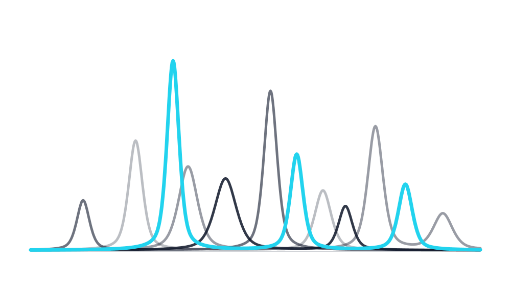
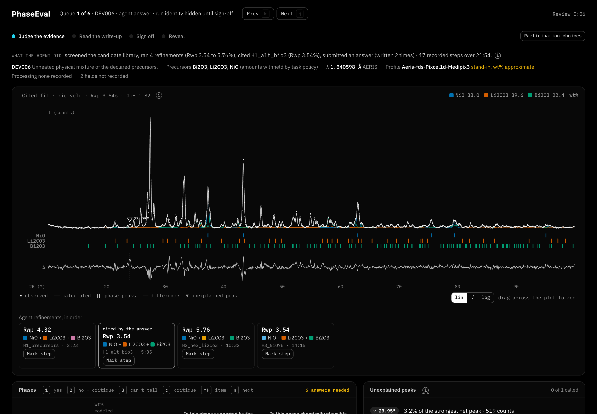

<p align="center">
  <picture>
    <source media="(prefers-color-scheme: dark)" srcset="docs/phaseeval-logo-dark.svg">
    
  </picture>
</p>

# PhaseEval

**Expert Review Eval Environment/Interface for Agentic XRD Analysis**

by Gabe Graves @ Detrix.ai

PhaseEval lets a diffraction expert check the phase identifications that an AI agent makes from powder X-ray diffraction (XRD) patterns, and turns those checks into records that later models are graded against. It runs on your own computer and opens in your browser.

PhaseEval reviews the output of AgentXRD, our XRD analysis agent. This repository holds:

- PhaseEval itself: the review workbench, triage, the scorecard and qualification cases.
- The BGMN refinement code that refits use.
- `harness/`: AgentXRD's four analysis tools, `harness/agent/run_agent.py` (runs any OpenAI-compatible model with those tools on a case in one command), and a DEV006 example with open COD structures.
- Import and export commands that bring your own runs into PhaseEval (`python -m phaseeval.workbench.cli`).
- `scripts/submit_run.py`, which submits an export to the public dataset [kineticdrive/phaseeval-runs](https://huggingface.co/datasets/kineticdrive/phaseeval-runs) as a pull request for review.
- Six AgentXRD runs by Qwen3.6-27B to review.

The Harbor task builder, the candidate CIF library, the GSAS-II and Profex importers and the private reinforcement learning wrapper are not included; `rl/` holds the public part of the RL work and its plan. The one-page write-up is [docs/PhaseEval-writeup.pdf](docs/PhaseEval-writeup.pdf). "Run your own agent" below gives the commands.



## From failure to fix

```bash
PYTHONPATH=src uv run --project launcher python scripts/failure_brief.py EXPORT_DIR [--run ID] [--out brief.md] [--json]
```

The brief shows how one run failed: the case and model, each workflow step's outcome (pass, fail or unassessed) and the source that decided it (deterministic check, model judge or human label), the recorded evidence behind each failure (residual peak height, Rwp, answer against the cited fit), any reviewer critique, and a "Where to look" line that points each failed step at a harness tool call or at the model's final answer. Fields the records lack are named in the footer, not filled in.

A human expert or another agent can read the brief (or its `--json`) and change the harness or retrain the model. The same cases can then grade the change. Example: `docs/examples/failure-brief/`.

## Coming very soon: RL training on Prime Intellect

Next is one-click setup of PhaseEval as a Prime Intellect environment, with RL training runs directly on the platform, so the cases that grade your agent can also train it. Where it stands today, measured on 2026-10-22: a wrapper for Prime Intellect's `verifiers` library passes its tests on synthetic cases in our private repository (30 of 30, and 65 of 65 for its port to `verifiers` 0.4). It depends on private AgentXRD modules, so it is not public yet, and no model has been trained with it. The public part is in [`rl/`](rl/): a replay scorer over the six public episodes and the step-by-step plan.

## What AgentXRD does

AgentXRD takes a powder pattern and the sample's declared precursors. A language model (in the bundled runs, Qwen3.6-27B on our own GPU) searches a crystal structure library for candidate phases. It runs Rietveld refinements in BGMN through recorded tool calls. It then reports the phases, their amounts and the fit it relied on.

A low fit statistic does not prove that the phase list is right. Someone who knows diffraction still has to look. PhaseEval is where they look.

## What PhaseEval does

- **Triage.** PhaseEval reads each answer's checks and routes it to an expert when a check flags it. One check is a residual peak at or above 5 percent of the strongest net peak. Another is an answer that differs from the fit it cites. Weaker residual peaks are listed for review. The routing threshold is provisional.
- **Expert review.** The review page shows the evidence first: the fit with unexplained peaks marked, each phase's calculated peaks, and chemistry evidence per phase (charge balance, distance from the convex hull with its source, element balance). The agent's write-up comes next, then a rubric. The rubric asks whether each phase is supported by the pattern and chemically plausible for the sample, whether the amounts are defensible on their stated basis, and whether the fit supports the conclusion. For a rater who has not seen it, the server withholds the reference answer until it has stored that rater's sign-off.
- **Refit.** The expert can remove a phase or add one and refit in BGMN. The refit appears as a child attempt beside its parent. A DEV006 refit takes about two minutes at 8 threads.
- **One-click report.** After their sign-off, the rater can download an analysis report and the raw files. The report states how the server recorded the sign-off, for example "owner, revealed".
- **Scorecard.** The scorecard shows every agent run step by step: phase search, phase selection, refinement setup and convergence, quantification, and final answer. Each step reads pass, fail or unknown, and names the source that decided it: a deterministic check, a published reference answer, a model judge or an expert label. This repository ships no reference answers and no labels. On the bundled data only the refinement step is decided, by its check, and the other steps read unknown.
- **Qualification.** Eligible expert judgments become qualification cases, and a model's answers are graded against them with accepted and rejected rates kept apart. Qualification needs expert labels. The bundled demo has none, so this repository shows qualification only in its code.
- **Export.** Episodes, answer snapshots, labels and step feedback export as versioned JSON lines with JSON Schemas in `schemas/` and a validator in `scripts/workbench/validate_eval_dataset.py`.

## Install and run

PhaseEval runs on macOS and Linux. The Windows launcher is included but has not been tested. The first start needs an internet connection. It installs [uv](https://docs.astral.sh/uv/), the Python manager PhaseEval runs on, if uv is missing, and uv then installs Python 3.12 and the locked dependencies into the repository's `launcher/.venv`.

To run PhaseEval by double-click:

1. Download this repository and unzip it, or clone it with git.
2. Open the folder and double-click the launcher for your system:
   - macOS: `PhaseEval.command`. If macOS blocks it, right-click it, choose **Open**, then confirm.
   - Linux: `phaseeval.sh`. To add PhaseEval to the app menu, run `./phaseeval.sh --install-desktop` once.
   - Windows: `PhaseEval.bat`.
3. Wait for your browser to open on the PhaseEval scorecard. You are signed in already. The **Review page** link opens the review queue.

To install and run from a terminal in one line:

```sh
git clone https://github.com/gabegraves/phase_eval.git && cd phase_eval && ./phaseeval.sh
```

A terminal window stays open while PhaseEval runs. To stop PhaseEval, close that window or press Ctrl+C in it. Double-clicking the launcher again while PhaseEval runs opens a new browser tab on the running server.

The launcher serves on `127.0.0.1` only, from the first free port from 18800. It creates fresh sign-in tokens on every start, keeps them in its state folder with owner-only permissions, and deletes them on stop. The browser receives them through a one-time code that expires after 120 seconds. To change the port, the data or the BGMN location, edit `launcher/phaseeval.toml`. Each setting is explained in that file.

### BGMN

Refits need BGMN, a Rietveld refinement program by J. Bergmann (http://www.bgmn.de). BGMN is third-party software with its own terms, so this repository does not include it. PhaseEval looks for BGMN in `~/.axa/bgmn`, in a Profex-BGMN install and on your `PATH`. If none is found, PhaseEval downloads BGMN on first use into `~/.axa/bgmn` from the mirror that the [DARA](https://github.com/CederGroupHub/dara) project uses. If the download fails, PhaseEval still runs, and the refit buttons are turned off with a note that says how to install BGMN. To turn the download off, set `bgmn = "none"` in `launcher/phaseeval.toml`.

## Run your own agent

You can run your own agent on your own case and review the run in PhaseEval. The import and export commands work offline and make no network calls.

1. Run the agent on your case. Point `--base-url` at your own model server.

   ```sh
   PYTHONPATH=src launcher/.venv/bin/python harness/agent/run_agent.py --input-dir cases/my-case --case MY001 --base-url <your model server>/v1 --model <your model> --out jobs/my-job/r1
   ```

2. Import the run into your local PhaseEval store. This is the store the launcher serves.

   ```sh
   PYTHONPATH=src uv run --project launcher python -m phaseeval.workbench.cli import --case-dir cases/my-case --run-dir jobs/my-job/r1 --case MY001
   ```

   A case of your own needs no labels. If the case folder has no `case_labels.json` or `custody.json`, the import marks it as a user case with no reference answer and no labels, and prints a note that says so. The import refuses a run whose files do not hash to the case's manifest. It also refuses an answer that names a phase outside the case's candidate library.

3. Open PhaseEval with the launcher and review the run in the browser. Then export the store.

   ```sh
   PYTHONPATH=src uv run --project launcher python -m phaseeval.workbench.cli export --out export
   ```

   The export is a dataset folder that `scripts/workbench/validate_eval_dataset.py` accepts. Its episodes are in `export/episodes.jsonl`. It carries no local paths and no network addresses.

4. Submit the run if you want to share it.

   ```sh
   hf auth login
   PYTHONPATH=src uv run --project launcher --with jsonschema --with huggingface_hub python scripts/submit_run.py export/episodes.jsonl --name <your handle> --i-hold-the-rights
   ```

   This uploads the file to a public Hugging Face dataset as a pull request. The maintainers review it before it is merged.

## What is measured and what is not

The bundled data are six AgentXRD runs by Qwen3.6-27B: three on DEV006 and three on DEV102. All six answered within the 3,440-second budget. All six reported the phase list of the published reference.

On DEV006, the eight-minute scan of an unheated mix of NiO, Li2CO3 and Bi2O3 from the DARA benchmark, the Qwen answers leave a residual peak at 23.95 degrees. Its height is 3.18 percent of the strongest net peak in all three runs. At that angle the three precursors contribute almost nothing to the fit. The check lists the peak for review. It is below the 5 percent routing threshold, so triage does not route this case. DARA's own first solution reported Bi2CO5 there, and the published reference omits it. Whether Bi2CO5 is present is an expert call. PhaseEval scores none of these answers.

At 5 percent of the strongest net peak, the K2 check flagged 21 of 25 reference-list near misses and 1 of 33 reference-list matches. These figures come from a private research note that is not yet published. They were measured on seven scans from one instrument. The threshold was chosen on those same scans.

We do not claim:

- that Bi2CO5 is present in DEV006;
- that any agent is more accurate than another (three runs per case is no accuracy comparison);
- any learning gain or training result (no model was trained on this data);
- any agreement between a model judge and experts, or any calibrated judge performance;
- held-out accuracy, routing recall or a qualification pass rate;
- scientific validation of any analysis;
- that blindness is proven over the whole server. Property-based regression tests check that no reference answer or other rater's label reaches a blind rater's view on the routes they cover.

## Data

`data/dataset-v0-public/` is the public export of the six Qwen runs. `data/README.md` describes each file, how the records were made, and what is missing. The demo store that the launcher unpacks on first start, `launcher/demo/phaseeval-demo.tar.xz`, holds the same six runs rebuilt as a review store, with a public-scope export of that store beside it. The rebuild gives the snapshots new digests, so the two exports hold the same runs under different digests.

The data contain no expert labels, no model-judge labels, no sign-offs and no reference answers. The labels you make in the demo stay in your own state folder.

`data/workbench/cases/` holds the three scans the demo cases use: DEV001 and DEV006 from the DARA benchmark, and DEV102 from the Precursor Genome release. Both sources are CC BY 4.0. `NOTICE` gives the full attribution.

## Run the tests

From the repository root, after the launcher has run once:

```sh
uv run --project launcher --with pytest --with hypothesis --with jsonschema python -m pytest
```

## References

- The A-Lab paper: Szymanski et al., "An autonomous laboratory for the accelerated synthesis of inorganic materials", Nature 624, 86-91 (2023), https://doi.org/10.1038/s41586-023-06734-w
- The critique of its phase calls, and the source of the quote "no value of Rwp or χ2 alone can ever be sufficient to conclude that a model is even approximately correct": Leeman, Liu, Stiles, Lee, Bhatt, Schoop and Palgrave, "Challenges in High-Throughput Inorganic Materials Prediction and Autonomous Synthesis", PRX Energy 3, 011002 (2024), https://doi.org/10.1103/PRXEnergy.3.011002
- DARA benchmark data (the demo scans), CC BY 4.0: https://doi.org/10.5281/zenodo.17410051
- Crystallography Open Database (the open structures), CC0: https://www.crystallography.net/cod/

## License

PhaseEval is licensed under the Apache License 2.0 (see `LICENSE`). `NOTICE` lists the third-party code and data in this repository and their licenses: DARA code (MIT), the DARA benchmark scans and the Precursor Genome scan (CC BY 4.0), Crystallography Open Database structures (CC0), and Materials Project hull values (CC BY 4.0). BGMN is not included.

## Citation

If you use PhaseEval, cite this repository:

```bibtex
@software{phaseeval2026,
  author = {Graves, Gabe},
  title  = {PhaseEval: Expert Review Eval Environment/Interface for Agentic XRD Analysis},
  year   = {2026},
  url    = {https://github.com/gabegraves/phase_eval}
}
```

If you use the bundled scans, also cite their sources as listed in `NOTICE`, including the DARA paper: Chemistry of Materials 38, 1364 (2026), https://doi.org/10.1021/acs.chemmater.5c02820.
