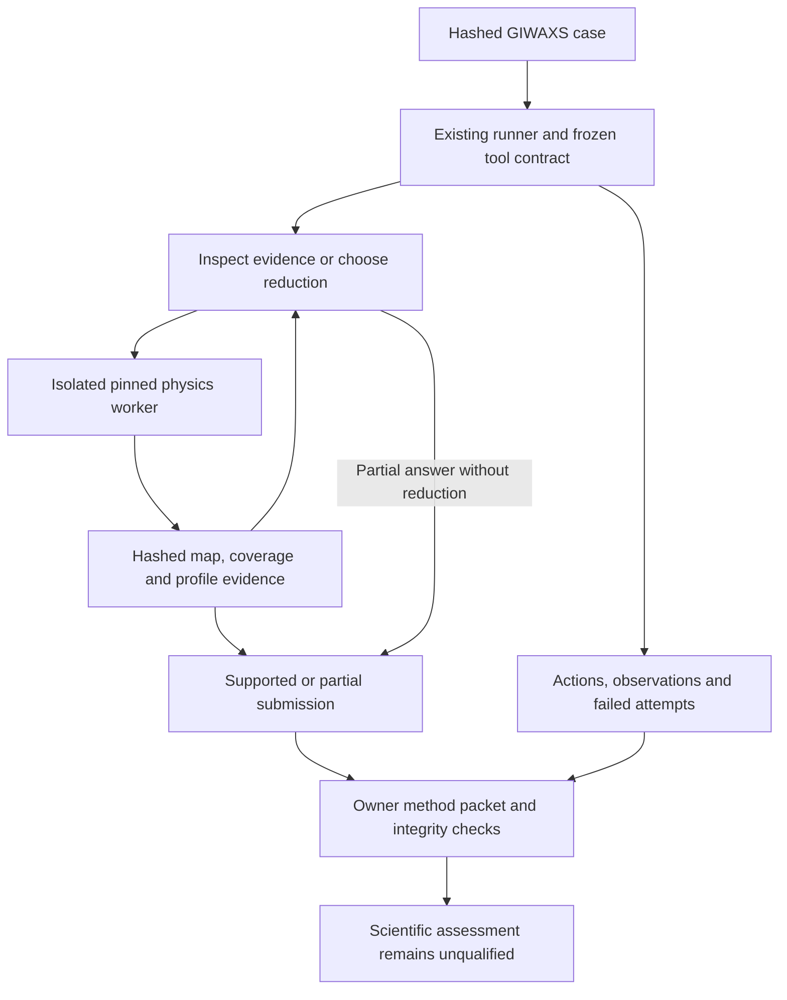

# GIWAXS development environment

## Goal Capsule

Run real GIWAXS reductions through PhaseEval's existing agent loop, preserve the choices and evidence delivered to the actor, and export an inspectable method record. Prove engineering behavior on the public synchrotron bundle without claiming scientific reward validity or learning.

The user's request and repository `AGENTS.md` govern scope. The implementation owns local proof, code review and delivery. Stop promotion to scientific rewards, expert sign-off or held-out evaluation until the corresponding evidence exists; those limitations do not block this development environment.

---

## Product Contract

### Problem and scope

The public GIWAXS archive has already been executed successfully in its supplied notebook. PhaseEval can currently run powder-XRD agents and preserve their trajectories, but its input, refinement and reviewer schemas cannot truthfully represent detector images, reciprocal maps or reduction choices. An XY suffix is insufficient: the published numerical output uses q = 2π/d, while plots also use s = 1/d, both in inverse nanometres.

This slice supports one known public synchrotron case from Zenodo DOI 10.5281/zenodo.18484796, under CC BY 4.0. It is development data. Laboratory reconstruction, calibration fitting, phase identification/quantification, independent scientific labels, reward qualification and training are outside scope.

### Requirements

**Evidence and execution**

- R1. Admit an explicit versioned GIWAXS case with checked raw detector, supplied geometry and mask hashes, source/license attribution, known experimental context and explicit unknowns. Never manufacture CIFs or call it a refinement.
- R2. Give the actor bounded native evidence reads, reciprocal transformation with explicit geometry/mask policy, line extraction, profile comparison and supported/partial submission. Derived evidence must preserve coordinate definition, units, coverage and immutable parent identities. Exclude uncovered bins explicitly without deleting measured zero or negative intensities.
- R3. Record requested and executed geometry, requested and realized ROI, selection/aggregation conventions, software versions, input/output hashes and warnings. Alternative geometry is an exploratory assumption, not a correction to acquisition truth. Comparison reports common support and interpolation; it rejects incompatible coordinate conventions.

**Methods and accounting**

- R4. Reuse existing runner chronology, shown-versus-full observations, failure receipts, timeout controls and predeclared attempt accounting. Keep actions that fail and scheduled attempts that never run. Bind the tool contract, worker code and observed interpreter/pyFAI/pygix/numpy runtime versions to the comparison identity.
- R5. Export a versioned owner-only review packet plus a readable method record. Include ordered actions/results, submitted claims, evidence links, deterministic integrity checks and explicit unassessed scientific questions. Optional method annotations must cite existing events and have unqualified human/model provenance; never turn annotations into scientific rewards or expert certification.
- R6. Report scientific reward as unavailable regardless of successful reduction, method annotation or valid JSON. A powder scorecard must be rejected for a GIWAXS episode. Existing powder behavior and schemas remain compatible.

**Proof**

- R7. Supply a reproducible real-bundle proof through the same runner/tool path, a numerical reproduction check, contrasting mask/ROI decisions, rejected malformed or tampered evidence, a justified partial result, and missing/failed attempt accounting. Label scripted actor responses as such. Scientific claims stay unvalidated and all related data remain one development family.

### Actors and flows

The actor is an agent using the existing OpenAI-compatible runner. A developer can exercise the exact same operations with scripted replies for deterministic proof. An owner inspects the exported method packet and may attach an explicitly unqualified assessment. This slice adds no rater-facing route and makes no blindness claim.

Acceptance examples: a changed mask file is refused before use; q and s profiles cannot be silently compared; an empty/out-of-range ROI is refused; an uncovered bin is not a measured zero; changing the window produces another cited artifact rather than overwriting the first; a partial answer remains possible without a reduction; an invented review citation is refused; successful reductions still yield zero known scientific rewards.

---

## Planning Contract

### Key Technical Decisions

- KTD1. Extend `harness/agent/run_agent.py` by explicit task kind, preserving its loop and accounting. Keep GIWAXS domain operations in `harness/giwaxs/` rather than generalizing powder action trees. Reuse `checked_bytes`, strict JSON, atomic output and registered handles from the existing harness. Governs R1–R4.
- KTD2. Run a fixed standalone GIWAXS worker under an explicit `--giwaxs-python` interpreter. The proven runtime is Python 3.10.15, pyFAI 2023.3.0 and pygix 2022.11.14; PhaseEval requires Python 3.12. Preserve the root dependency stack and record actual worker versions rather than assuming a lock proves the installed runtime. A bounded version probe binds runtime before provider work; actual worker execution confirms it. Keep TIFF/EDF decoding and reciprocal transformation in the worker; extraction, comparison and NPZ reads use the launcher's existing numpy dependency. Reuse process-group termination and strip provider credentials from physics subprocesses. This deliberately reproduces the archived implementation; migrating to a newer scientific kernel requires a separate numerical characterization. Governs R2–R4.
- KTD3. Export an owner-only development packet, not a powder `AnalysisSnapshot` or false `refinement_bound` import. The current workbench's blind projection, phase model and trajectory-review prompt are powder-specific. Full blind GIWAXS workbench admission is a later coherent change; this slice supplies typed evidence and chronology intended as input to that design, with future compatibility unvalidated. No new server routes or separate interactive reviewer app. Governs R5–R6.
- KTD4. Mechanical checks describe lineage, coverage, coordinate and event validity. Scientific method annotations are separate and unqualified. Preserve the powder reward gate; explicitly recognize reduction-bound attempts without granting scorecard attachment or a scalar reward. Governs R5–R7.
- KTD5. Reproduce the supplied notebook's map and upper-exclusive nearest-bin strip extraction as one declared mode, and offer coverage-aware extraction separately. Store coverage with either mode. Notebook mode retains fill-value contributions for reproduction and flags incomplete coverage; only coverage-aware mode excludes uncovered bins from aggregation. Comparisons use supported bins and never treat fill values as measurements. A mask omission or changed ROI is not automatically a scientific error; comparisons measure effects, not reward. Governs R2–R3, R7.

### Risks and assumptions

The source bundle contains one exposed specimen, supplied geometry without a complete uncertainty budget, and no independent scientific reference labels. Baseline equality checks are engineering regressions against the previously executed notebook, not validation against withheld truth. Invalid action arguments, paths, output replacement, stale citations and timeouts must fail closed. A packet is an integrity-bound owner artifact, not a tamper-proof attestation against someone who can rewrite the entire local store.

Successful GIWAXS submission is terminal, including within a batch of tool calls; rejected submission remains recoverable. Each call has a runner-generated event identity and a distinct succeeded/rejected/failed outcome independent of transport completion. Publish derived handles only after successful worker completion and hash verification. Runtime mismatch fails setup before provider calls. An owner packet is stored outside the actor registry after episode finalization; owner-only describes its audience, not a newly enforced filesystem permission boundary. Comparison must not interpolate across uncovered gaps.

No new external literature survey is required to choose this implementation: the actual archived notebook and measured reproduction are the working specification. Preserve source attribution and the exact archive SHA256 `fcc15f7f3a7d2b2824435975dbcbdabc1f16a29ff1755264857c32a9df42079f`. Keep the archive, raw arrays and generated proof outputs outside version control.

---

## Implementation Units

### U1. Typed GIWAXS evidence and real reduction tools

- Goal: implement R1–R3 using KTD1, KTD2 and KTD5.
- Files: `harness/giwaxs/environment.py`, `harness/giwaxs/worker.py`, `harness/giwaxs/requirements.txt`, `src/phaseeval/giwaxs.py`, corresponding `schemas/` contracts and `tests/harness/test_giwaxs.py`.
- Approach: validate a versioned case; register only declared files; use immutable owned handles for input/map/profile/comparison evidence. Expose bounded native pages with coordinate/coverage metadata. Execute the known reciprocal transform and explicit extraction/comparison policies. Persist input, parent and output hashes and actual runtime. Implement supported/partial submission with owned, hash-checked citations and explicit limitations/evidence still needed. Reject nonfinite/extra/invalid arguments and unsafe paths. An action label cannot be reused even after failure.
- Test scenarios: hash and symlink substitution; unsafe labels; empty and collapsed ROI; zero/negative intensity versus absent coverage; q/s mismatch; common-support comparison; failed worker does not register successful outputs; parent tampering and cross-episode citations.
- Verification: focused synthetic numerical/trust-boundary tests, schema parity and later real-bundle proof. Synthetic data test mechanics only.

### U2. Existing runner and attempt profile integration

- Goal: implement R4 and R6, depending on U1's interface; follows KTD1, KTD2 and KTD4.
- Files: `harness/agent/episode.py`, `harness/agent/run_agent.py`, `src/phaseeval/reward_profile.py`, `tests/harness/test_episode_integrity.py`, `tests/harness/test_run_agent_output.py`, `tests/rl/test_reward_profile.py` and GIWAXS runner tests.
- Approach: select GIWAXS prompt/tools at every fingerprint, recheck and provider call. Preflight GIWAXS before any powder library reads. Reuse the existing loop, process cancellation and output recovery; preserve failed setup receipts. Declare explicit reduction-bound/no-reduction status and carry all scheduled attempts through profiling with null scientific reward. Reject powder scorecard attachment.
- Test scenarios: ordinary powder fixture namespaces still work; wrong task-kind/case pairing fails; changing worker source, runtime versions, prompt, tool schema or input is detected; partial submission works; timeout retains an explicit failure; missing and failed slots remain in the denominator.
- Verification: harness and reward-profile regression suites plus scripted real-physics proof.

### U3. Frozen inspectable method packet and unqualified review

- Goal: implement R5 and R6, depending on U1 and U2; follows KTD3 and KTD4.
- Files: `harness/giwaxs/review.py`, `src/phaseeval/giwaxs.py`, `schemas/giwaxs-*.schema.json`, `tests/harness/test_giwaxs_review.py`.
- Approach: freeze hashes of the receipt, chronology, submission and referenced artifacts; export typed owner JSON and a readable Markdown report. Distinguish actor-delivered observations from executor-only output. Include requested/executed parameters and realized ROI. Present scientific questions about geometry, mask, coverage, alternatives and stopping as unassessed. Allow a separately supplied unqualified annotation with pass/fail/defer, supporting event IDs, earliest error and optional later repair, all bound to the packet. Validation checks citations and chronology, not scientific truth. Source/model identity and qualification limitations remain explicit.
- Test scenarios: edited source/artifact, missing event, invented/future repair, unsupported reviewer authority and forged reward field rejected; failed/no-reduction packet still reviewable; schema roundtrip; no annotation grants reward or workbench admission.
- Verification: packet/schema tests and inspection of the actual proof packet. No blind-rater test expansion is needed because no rater route or projection is changed.

### U4. Real-bundle proof and developer instructions

- Goal: demonstrate R7 and all integrated requirements, depending on U1–U3.
- Files: `scripts/prove_giwaxs_environment.py`, `harness/giwaxs/README.md`, top-level `README.md`, `docs/research/giwaxs-development-verification.md`.
- Approach: build the versioned case from the checked deposited archive; retain DOI/license and hash manifest. Run a scripted agent through the existing runner and actual isolated worker. Reproduce the original map/strip and a masked/changed-ROI contrast; test deterministic repeat and selected malformed operations. Inspect raw/map/profile pages and submit a bounded conclusion with limitations. Include no-reduction/partial and failed/missing scheduled attempts. Export the owner packet and retain command, versions, measured outputs and check receipts. The proof takes explicit external input/runtime/output paths, never hard-coded developer paths.
- Verification: development invocations may report baseline comparison unavailable, but delivery requires the explicit hash-recorded prior notebook baseline and a passing map/profile numerical comparison at rtol 1e-6, atol 1e-5, with exactly matching coordinate axes. The baseline is a local re-execution of unchanged deposited notebook cells, not deposited numerical ground truth. These are engineering reproduction tolerances, not scientific acceptance criteria. Compare the notebook's unmasked map/strip with a supplied-mask reduction over q = 2π × [0.3, 3] nm^-1, reporting the tiny observed difference; compare a changed qz window descriptively over the same support. Run the repository suite after targeted checks. Required real-worker proof cannot be satisfied by a skipped test. Record any legitimate unrelated skips and inspect the readable packet.

---

## Verification Contract

Use the repository's Python 3.12 launcher runtime for PhaseEval tests and the isolated known GIWAXS runtime only for physics. The supported test command is `uv run --project launcher --with pytest --with hypothesis --with jsonschema python -m pytest`. Start with the touched harness, GIWAXS and reward-profile tests; then run the full repository suite once changes and review fixes settle. The real-bundle proof must invoke physics, not replay saved tool outputs. It may script provider replies, clearly identified in its report.

Type/schema parity, parent/input hash checks, numeric conventions, coverage, failed/missing denominator preservation and no-reward behavior are required automated gates. Human-readable proof review checks that choices and limitations are understandable. A local code review must be completed and material findings resolved before delivery. The plan remains a decision artifact; execution evidence goes into the verification report.

## Definition of Done

The runner/tool path is proven with scripted actor replies that inspect actual raw/map/profile evidence, choose explicit reduction parameters, compare alternatives and submit a cited bounded or partial answer. Live-model usability remains unestablished unless separately exercised and reported. An owner can reconstruct and assess that method from a frozen packet, including failures and what the actor actually saw. The real deposited bundle executes successfully and numerical/lineage checks pass. Existing powder tests remain compatible. Scientific reward, expert qualification, held-out performance and RL improvement remain explicitly unestablished.
